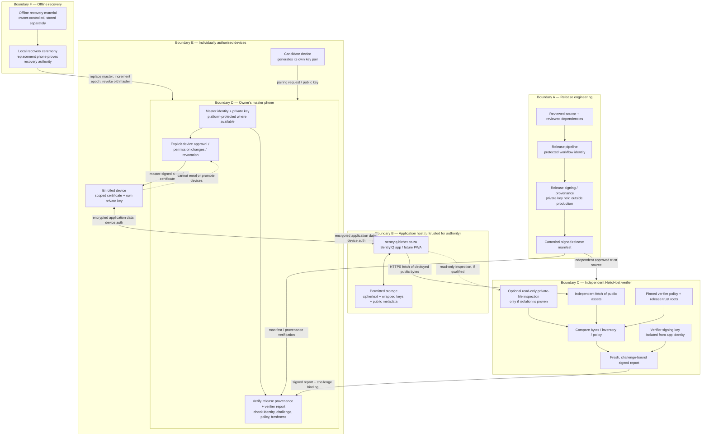

# SentryIQ — Phase 1.1 Data-Flow and Trust-Boundary Design

**Status:** Proposed design artifact; not implemented or deployment-approved.  
**Canonical application:** `https://sentryiq.bichet.co.za`  
**Application host:** existing SentryIQ host  
**Independent security node:** one specialised verifier on HelioHost  
**Normal device-authority root:** owner's master phone  
**Scope:** Phase 1.1 of the design plan. This document maps components, trust boundaries, information flows, authority, and principal compromise cases. It does not select final algorithms, key sizes, wire formats, or storage schemas; those belong to later Phase 1 items.

## 1. Design invariants

1. There is one SentryIQ application at the canonical origin and exactly one independent specialised HelioHost verifier. HelioHost is not a second application installation.
2. The owner's phone is the sole normal authority for device enrolment, permission changes, and revocation.
3. Every additional device creates and retains its own device key. No additional device receives the master private key or the authority to enrol another device.
4. Offline recovery is a separate, owner-controlled emergency authority for replacing a lost master. It is not a second everyday master and is not held by either server.
5. The application host is potentially compromised. It may relay data and store permitted ciphertext/public metadata, but it is not trusted to mint device authority, release trust, or verifier results.
6. The HelioHost verifier has a narrow read/measure/report role. It cannot approve devices, decrypt user data, alter release policy, or write to the application host.
7. Release signing, verifier report signing, master-device authorisation, per-device identity, data encryption, recovery, and session credentials are distinct cryptographic roles. They must never share a private key.
8. No live infrastructure is assumed to exist. No provisioning, production key generation, trust-baseline initialisation, release publication, or deployment is authorised by this design work.

## 2. Trust-boundary and data-flow diagram

The arrows describe intended authenticated or integrity-checked flows, not a claim that the current repository implements them.

### Flow interpretation

- **Release path:** reviewed source and dependencies enter a protected release workflow. The workflow emits a canonical manifest and provenance. The application host serves the resulting release but cannot make an altered release trusted merely by changing its own files or metadata.
- **Verifier path:** HelioHost obtains approved release metadata independently, fetches the live public assets itself, measures the returned bytes, and—only if later qualified—inspects selected private files read-only. It signs a bounded report. The phone validates the report rather than trusting a status page or an unsigned response.
- **Device path:** a candidate device creates its own key pair and presents a short-lived pairing request. The master phone reviews identity and requested scopes, performs fresh user verification, and signs the enrolment grant. The application host may relay/store the grant but cannot create or broaden it.
- **Data path:** devices encrypt/decrypt locally under the later-defined envelope-encryption design. The application host stores ciphertext and wrapped key material only. Exact DEK wrapping and synchronisation rules remain Phase 1.6 work.
- **Recovery path:** the owner uses separately stored offline material in a local recovery ceremony on a replacement phone. Recovery replaces the master, increments the authority/registry epoch, revokes the old master, and invalidates old sessions/grants. The servers cannot perform recovery alone.

## 3. Boundary inventory

| Boundary / component | Data it may hold | Secrets it may hold | Authority it has | Explicitly does not have |
|---|---|---|---|---|
| Application host | Encrypted records, ciphertext, wrapped DEKs, public device certificates/metadata, short-lived protocol state, permitted release files | No master private key, recovery secret, plaintext DEK, release-signing key, or verifier-signing key | Serve the app; store/relay permitted data and signed public artefacts | Mint device certificates, broaden scopes, approve releases, sign verifier reports, decrypt user content, recover a master |
| HelioHost verifier | Approved release metadata, measured hashes/inventory, bounded evidence and report metadata | Dedicated verifier signing key; narrowly scoped read credentials if required and qualified | Measure configured public assets and approved private-file evidence; sign a fresh result | Device enrolment/revocation, data decryption, release approval/policy mutation, application writes |
| Master phone | Device registry view, public trust roots, certificates, local user data while in use | Master private key; any locally usable DEK material; short-lived session credentials | Sole normal device approval, scope changes, revocation, sensitive local trust decisions | Export master key; delegate normal enrolment authority to another device; let app host replace trust roots |
| Additional device | Its own data view, own certificate, public trust material, locally available encrypted/decrypted content | Its own private key and only the DEKs/wrappings needed for its granted scope | Act within its own certificate scopes | Enrol/promote devices, change root trust, recover/replace master, widen its own scope |
| Release pipeline | Source revision, build inputs, artifact, manifest, test/provenance records | Release-signing capability only within protected workflow boundary | Produce signed release evidence under pinned policy | Decide device authority, sign HelioHost measurements, access user DEKs, silently alter approved trust policy |
| Offline recovery authority | Recovery instructions and recovery proof material, stored offline | Recovery secret/key material, separately protected | Authorise one deliberate replacement-master recovery ceremony | Everyday sign-in, routine device enrolment, decrypt server-held user content by itself, be held by either server |

**Plaintext rule:** plaintext user data and usable DEKs may exist only in an authorised device's execution context when needed. The application host and verifier must never receive plaintext user content or DEKs. Browser execution means this is a design objective requiring careful implementation, not a guarantee supplied by JavaScript or WebCrypto alone.

## 4. Authenticated flow contracts

These are protocol-level requirements; concrete encodings, algorithms, sizes, identifiers, and rotation rules are deliberately deferred to Phase 1.3–1.8.

| Flow | Sender → receiver | Required binding / checks | Failure behaviour |
|---|---|---|---|
| Release evidence | Release pipeline → independent trust source / verifier | Immutable source commit, workflow identity, artifact digest, manifest version, approved signer identity and provenance policy | Reject unsigned, untrusted, ambiguous, or policy-mismatched release |
| Live measurement | Application origin → HelioHost fetcher (fetch initiated by verifier) | Exact canonical origin, redirect policy, path normalisation, content type, response bytes, cache/variant handling, expected inventory | Mark verification failed/incomplete; do not silently omit missing or unexpected paths |
| Private-file evidence | Application host filesystem → isolated read-only verifier collector | Only after provider capability and isolation are demonstrated; fixed allowlist, stable file identity, bounded read-only access, no app-writable signing key | Do not claim private-code integrity if access/isolation cannot be demonstrated |
| Verification report | HelioHost → master phone (possibly relayed by app host) | Verifier key identity, report schema/policy version, release identity, measured digests, challenge/nonce, issue time, expiry, explicit pass/fail | Fail closed on invalid signature, wrong challenge, stale/expired, replayed, missing, or failed evidence |
| Device pairing | Candidate device → master phone (QR/local transfer or other reviewed channel) | Fresh short-lived challenge, candidate public-key fingerprint, protocol version, human-readable device identity and requested scopes | Expire and reject replayed, altered, or ambiguous request |
| Device enrolment | Master phone → candidate device / application relay | Master signature, device public key, stable device ID, explicit scopes, expiry, registry epoch, fresh user verification | No certificate without explicit master approval |
| Device operation | Enrolled device → application host | Device proof of possession, certificate validity, scope, expiry, current registry epoch, session freshness | Reject expired, revoked, wrong-scope, stale-epoch, or invalid proof |
| Revocation | Master phone → relying components via application relay | Master-signed revocation, target device ID/key ID, monotonic registry epoch, event identity | Deny future authorisation; short-lived credentials bound stale/offline exposure |
| Recovery | Offline authority + replacement phone → local recovery ceremony; signed event propagated to relying components | Proof of offline recovery authority, new replacement key, explicit owner ceremony, epoch increment, old-master revocation | No server-only reset; if recovery material is lost, follow documented unrecoverable-loss procedure rather than bypassing authority |

The application host may relay signed objects, but every relying party must verify the relevant signature and bindings itself. Transport TLS is necessary but is not a substitute for end-to-end signatures, challenge binding, or authorisation checks.

## 5. Authority and state transitions

### Normal device lifecycle

1. Candidate generates its own key pair locally.
2. Candidate presents a short-lived pairing request.
3. Master phone verifies the request, displays the device and requested scopes, and obtains fresh user verification.
4. Master phone signs a certificate bound to the candidate public key, device identity, scope set, expiry, and current registry epoch.
5. Candidate proves possession of its private key and uses only the granted scopes.
6. Master phone can change scopes or revoke the device by signing a new authoritative state transition.
7. All relying components reject revoked certificates and stale registry epochs. Short credential lifetimes bound how long an offline component can remain unaware of a revocation.

No server-side account administrator, application-host process, HelioHost process, or additional device is an alternate normal enrolment authority.

### Master replacement

1. Replacement phone generates a new key pair locally.
2. Owner performs the offline recovery ceremony locally.
3. Recovery authorises the replacement identity and emits a signed recovery event.
4. The authority epoch advances; old master identity, sessions, pending pairing grants, and prior-epoch device authorisations are invalidated or require explicit re-issuance under the new epoch.
5. The owner reviews the device registry and re-authorises surviving devices as required.

The exact recovery secret format, threshold (if any), backup medium, anti-copy controls, and unrecoverable-loss policy remain to be specified before first initialisation. Recovery must not become an online support override.

## 6. Compromise and failure analysis

| Compromised component / event | Attacker may be able to do | Required containment / detection | Residual risk |
|---|---|---|---|
| Application host | Serve malicious JS/HTML, deny service, replay/withhold relayed objects, expose stored ciphertext and public metadata | Independent asset measurement; signed device certificates; client-side signature checks; strict CSP/dependency controls; minimise plaintext and key exposure; fail closed on bad verifier evidence | Same-origin malicious JS can execute in the browser and may invoke legitimate client-side key-use operations; server-side measurement cannot prove a clean browser runtime |
| HelioHost verifier | Forge its own reports, lie about measurements, deny service | Phone pins verifier public key and checks challenge/freshness; independent release evidence; narrow service; isolate key and policy; monitor key use; recovery/rotation plan | A compromised verifier signing key can forge measurements until revoked/rotated; a single verifier is a deliberate single verifier trust dependency |
| Master phone | Approve attacker devices or misuse master authority | Hardware-backed protection where available; fresh user verification; device lock; rapid recovery/revocation; signed audit events | A fully compromised/unlocked master can exercise its legitimate authority |
| Additional device | Expose its local data/keys and misuse its permitted scopes | Per-device keys/scopes; expiry; individual revocation; no enrolment authority; minimise local data | Already copied plaintext cannot be recalled; offline devices may not learn revocation immediately |
| Release workflow / signer | Produce malicious artifacts with apparently valid release evidence | Protected workflow identity and environments; least-privilege tokens; reviewed dependencies; immutable source/build provenance; independent verifier policy and approval roots | If the accepted signer/policy boundary itself is compromised, signatures can validate malicious releases |
| Offline recovery material | Replace master if stolen or copied | Store separately from phone and servers; protect against copying; use only through deliberate local ceremony; rotate after use or suspected exposure | Anyone possessing sufficient recovery material may be able to replace the master; physical loss can make recovery impossible |
| Browser / OS / service worker | Read plaintext during use, alter UI, intercept operations, invoke key-use APIs, persist malicious code | Minimise plaintext lifetime; strict CSP; dependency pinning/review; service-worker update controls; verify before sensitive operations where feasible; evaluate native companion | WebCrypto non-extractability does not prevent malicious same-origin code from asking the browser to use a key; OS compromise defeats browser-only assumptions |
| Network / relay | Observe metadata, delay, replay, or suppress traffic | TLS; signed payloads; challenge/nonce; expiry; monotonic epochs; replay stores where needed | Denial and traffic analysis remain possible; availability is not guaranteed |
| Shared-hosting isolation failure | Application account may read or alter verifier policy/key/evidence | Demonstrate filesystem/process/account separation, permissions, scheduler identity, egress, and app-host inability to access verifier assets before provisioning | If the provider cannot prove the boundary, HelioHost cannot be treated as independent; do not deploy the verifier there |

### Fail-closed conditions

Sensitive operations must be blocked when release provenance is invalid, verifier identity/signature is invalid, report is missing or stale, challenge does not match, policy version is unrecognised, device certificate is expired/revoked/wrong-scope, registry epoch is stale, or recovery state is ambiguous. Availability fallback must not silently convert an integrity or authority failure into success.

## 7. PWA and browser trust limitations

The repository audit found no tracked PWA manifest, service-worker entrypoint, or installability registration in the scanned browser JavaScript. The target PWA shell is therefore future work, not an existing security control.

- A service worker and JavaScript bundle cannot attest to their own integrity.
- A compromised application origin can deliver malicious code before a client-side check or can interfere with the check itself.
- A non-extractable WebCrypto key prevents ordinary key export through the API; it does not prevent malicious same-origin code from invoking permitted signing/decryption operations while the key is available.
- Browser profile sync, extensions, debugging interfaces, device malware, OS compromise, and physical access are outside the guarantees of a web-only key store.
- Use platform hardware protection where available, but do not claim uniform hardware-backed storage across browsers/platforms without testing.
- Keep high-value master authority and offline recovery separate from ordinary app storage. Evaluate a native companion or platform authenticator integration if browser controls cannot meet the required assurance.
- A successful HelioHost measurement is evidence about measured delivery and permitted inspected files, not proof that the browser, phone OS, or runtime is uncompromised.

## 8. HelioHost independence qualification gate

HelioHost remains a proposed verifier location until all of the following are evidenced in a separately authorised, non-production qualification:

- Provider terms permit the intended verifier and scheduled/persistent execution model.
- A distinct account/process/filesystem boundary exists; application-host credentials cannot read or modify verifier policy, signing key, evidence, or runtime.
- Verifier signing key is stored outside webroot and is not readable by application PHP or deployment identity.
- Private-file inspection, if claimed, uses a fixed read-only allowlist and cannot execute application-controlled code or write to the application.
- Scheduler/service identity, file permissions, process isolation, TLS validation, outbound network policy, log access, and failure behaviour are understood.
- Verifier obtains release trust metadata independently of the application host.
- Signing and report generation are bounded, challenge-bound, and auditable.
- A compromise or provider-account loss procedure exists, including verifier-key revocation and replacement.

If the provider cannot demonstrate sufficient separation, keep the verifier design unprovisioned and reassess the hosting boundary; do not weaken the independence requirement to fit shared hosting.

## 9. Explicitly out of scope for Phase 1.1

The following are intentionally not decided here and must be handled by subsequent plan items:

- Data classification and exact plaintext locations (Phase 1.2).
- Algorithms, key sizes, key IDs, rotation, and cryptographic protocol details (1.3–1.4).
- Supported-platform key protection and native-companion decision (1.5).
- Envelope encryption and DEK wrapping (1.6).
- Certificate schema, scopes, expiry, registry epoch, enrolment and revocation wire protocol (1.7).
- Recovery-material format and complete ceremony (1.8).
- Full threat-model test cases and acceptance criteria (1.9).
- Release manifest completeness, trust-root distribution, actual deployed-file inventory, and verifier implementation details (Phase 2).
- HelioHost provider qualification or any production/non-production provisioning (Phase 4).

## 10. Phase 1.1 completion checklist

- [x] Map application host, single HelioHost verifier, master phone, additional devices, release pipeline, and offline recovery.
- [x] Show intended information flows and trust boundaries.
- [x] Record permitted data/secrets and prohibited authority for each component.
- [x] Define authenticated-flow requirements and fail-closed conditions without prematurely choosing cryptographic parameters.
- [x] Record device enrolment, revocation, and master-replacement state transitions.
- [x] Analyse compromise of each major component and browser/PWA limitations.
- [x] Record HelioHost independence qualification as a gate, not an assumed fact.
- [x] Preserve the no-provisioning/no-production-key/no-deployment boundary.
- [ ] Owner/design review of the boundary model before Phase 1.2 is treated as accepted.

**Conclusion:** This is a coherent proposed data-flow and trust-boundary model for the agreed single-verifier, phone-rooted architecture. It is a design artifact only. It does not establish that the current application, PWA, browser key store, HelioHost account, or release pipeline already satisfies the model.
