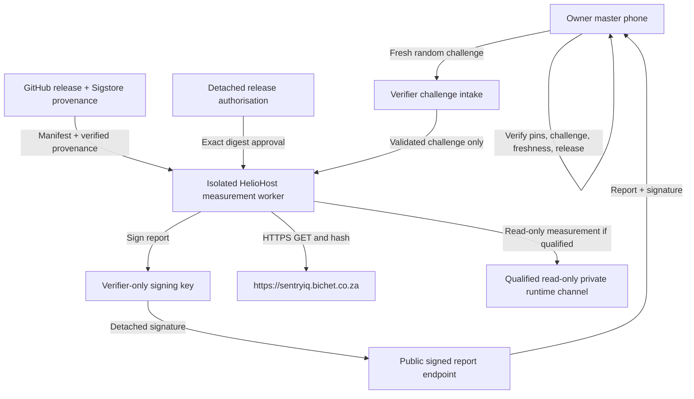

# Phase 2.4 — Single HelioHost verifier architecture and isolation design

**Status:** Design artifact complete; HelioHost qualification and owner/security approval remain prerequisites.  
**Application origin:** `https://sentryiq.bichet.co.za`  
**Independent service:** One specialised HelioHost verifier, not a second SentryIQ application.  
**Authority:** Measurement and report signing only.  
**Safety:** No HelioHost account, service, credential, key, scheduler, or deployment was provisioned or changed.

## 1. Purpose and non-negotiable boundaries

HelioHost is assigned one narrow responsibility: independently measure the release deployed at the canonical SentryIQ origin and, where the hosting provider and application host permit a genuinely isolated read-only mechanism, inspect selected private server-side runtime files. It signs a bounded verification report for the owner's master phone.

The verifier is not:
- A second SentryIQ application installation or a user-data store.
- A release builder, release authorisation signer, or TUF root authority.
- A device enrolment/revocation authority or master-device replacement authority.
- A Vault, Documents, or Gallery decryption service.
- An application deployment agent or remote repair service.
- A component with write credentials to the application host, GitHub repository, release assets, B2, database, or user files.

The verifier receives no master private key, device private key, DEK, VMK, PRF output, recovery material, application session, B2 credential, or application write credential. It does not run application PHP, load the application database, or use application-host code as its policy authority.

## 2. Trust and data-flow overview

The diagram is logical, not a statement that any current host or endpoint exists. The challenge intake, measurement worker, signing process, and public report retrieval must be separated by enforceable permissions. A single PHP request process that can both accept arbitrary requests and read the verifier private key is not an acceptable high-assurance design.

## 3. Recommended service shape

Use a small, single-purpose verifier with a bounded scheduled/CLI worker. A long-running daemon is not assumed to be available or permitted on the selected HelioHost plan. The exact execution mode is selected only after provider terms and account capabilities are qualified.

### 3.1 Logical components

1. **Challenge intake**
   - Accepts a strictly bounded request containing protocol version, random nonce, requested release/policy scope, and proof that the request originated from the expected owner phone protocol.
   - Does not have permission to read the signing key or alter verifier policy.
   - Writes only a validated, short-lived challenge record to a private queue.
   - Cannot select filesystem paths, arbitrary URLs, executable commands, or a custom trust root.

2. **Measurement worker**
   - Runs under a separate OS/process identity or an equivalently enforceable isolation boundary.
   - Reads the fixed verifier policy and trusted release-authorisation metadata.
   - Obtains and verifies the canonical manifest, detached release authorisation, and GitHub/Sigstore provenance under pinned trust policy.
   - Fetches only the fixed canonical application origin and allowlisted paths from the verified manifest.
   - Reads selected private runtime files only through a separately qualified read-only channel.
   - Compares expected/observed digests and policy; fails closed on missing or ambiguous evidence.
   - Is the only component permitted to use the verifier signing key.

3. **Report store**
   - Stores completed signed reports and minimal non-secret evidence metadata.
   - Is outside the public webroot for writes.
   - Report retrieval is read-only and keyed by opaque report ID/challenge nonce.
   - The report endpoint cannot modify a completed report or invoke the signing key.

4. **Report retrieval**
   - Returns only the signed report and detached signature for the requested report ID.
   - Does not expose private files, verifier configuration, key material, challenge queue internals, stack traces, or arbitrary filesystem content.
   - Applies strict response size, content type, cache, and access controls.

5. **Alert/operations channel**
   - Delivers operational failure alerts through a separately authenticated channel.
   - Does not depend on the old Node 4 event plane.
   - Alert delivery failure is recorded and cannot convert a failed measurement into a pass.

### 3.2 Challenge processing without exposing the signing key

Preferred shared-host-compatible design, only if host permissions support it:
- The public intake process validates request shape and writes a challenge record to a private queue.
- The scheduled CLI worker, under a distinct process identity, consumes the queue, performs measurement, and signs the report.
- The public report handler can read completed signed report files but cannot read the private key, policy secrets, or write/replace report files.
- Queue records are treated as untrusted input; the worker validates nonce format, expiry, allowed release scope, and replay state again.
- Challenge records are one-use and deleted/expired only after durable completion or an auditable failure outcome.

If HelioHost cannot provide distinct identities/permissions so that the public request handler cannot read the signing key and cannot alter the worker's policy or completed evidence, this design is not qualified. Do not compensate by placing the private key in the public PHP request path.

An alternative dedicated process/service may be considered only if the provider permits it, its network exposure is constrained, and process/key isolation is demonstrable. A scheduled worker is preferred over an always-on daemon when the plan does not permit persistent services.

### 3.3 No application-host write path

The verifier makes outbound read-only HTTPS requests to the canonical origin. It does not receive an SSH shell, cPanel login, deployment token, FTP/SFTP write credential, database credential, or application API token.

For private-file inspection, evaluate a narrowly scoped read-only SFTP or host-side collector channel only if the application host can enforce:
- A dedicated read-only identity.
- Access only to the explicitly inventoried runtime files and required metadata.
- No directory listing or read access to credentials, private config values, sessions, user content, logs, keys, or backups unless separately justified.
- No write, rename, delete, chmod, command execution, or privilege escalation.
- Independent credential storage on HelioHost and no copy available to the application process.
- Host audit logs and a revocation path.

If these conditions cannot be demonstrated, private-file measurement is unavailable. A manifest, HTTP response, or application-host-supplied hash is not a substitute for independently reading the private file bytes.

## 4. Isolation and key custody requirements

The verifier signing key:
- Is generated only after HelioHost qualification and explicit owner authorisation.
- Is dedicated to one verifier identity and one report-signing purpose.
- Is stored outside the public webroot, outside the SentryIQ application host, and outside any directory writable by the public report/intake process.
- Is readable only by the isolated measurement worker/service identity.
- Is never passed through request parameters, environment dumps, command-line arguments, logs, reports, or public config files.
- Has a separately pinned public key and immutable key ID accepted by the master phone under Phase 2.3.
- Is rotated/revoked only through the owner-approved trust transition; the verifier cannot self-authorise a new key.

The verifier host must also protect:
- Fixed policy and trusted release-authorisation root metadata from public handler and application-host modification.
- Challenge queue and replay state against symlink/path attacks, untrusted path construction, and concurrent consumption.
- Signed evidence and monotonic release state against concurrent writes and rollback.
- Logs against secret leakage and unauthorised alteration.
- Service credentials with least privilege; ideally no application credential at all.

Separate Unix users and filesystem permissions are preferred. A shared-host account boundary is acceptable only if provider capabilities and adversarial tests demonstrate the same required isolation. Merely placing a key outside the document root is necessary but not sufficient if all PHP scripts execute as the same account and can read it.

## 5. Release and policy input validation

Before measurement, the worker independently validates:
1. Canonical format-3 manifest and strict JCS encoding.
2. Detached release-authorisation signature, key ID, policy, validity, release sequence, and exact manifest/ZIP digests.
3. GitHub/Sigstore provenance and exact repository ID, workflow identity, source ref, source commit, workflow commit, and subject digest.
4. The expected canonical application origin and deployment profile.
5. Minimum verifier policy version and current trust-store sequence.
6. The release sequence against its protected last-accepted state; a lower sequence fails unless an exact owner-signed rollback statement is present.
7. Challenge nonce, one-use state, requested release binding, and expiry.

The worker does not trust `VERSION` alone, a GitHub Release tag name alone, a checksum sidecar, a release description, an application-host database row, or a value supplied by the challenge requester.

The worker's trust roots are public metadata. It does not hold the release-authorisation private key, GitHub OIDC credentials, TUF root private keys, or master-device private keys.

## 6. Measurement responsibilities

### 6.1 Public HTTP assets

The worker fetches the exact HTTP assets declared by the verified manifest from `https://sentryiq.bichet.co.za`. Phase 2.5 defines the detailed HTTP algorithm, but the service contract requires:
- TLS certificate and hostname validation.
- No arbitrary redirects; any permitted redirect is explicitly constrained by policy and revalidated.
- Exact path, status, content type, response byte length, and SHA-256 measurement.
- Defined handling of compression/content encoding and cache variants so different byte representations cannot be confused.
- Checks for required security headers and cache policy.
- Rejection of path aliases, ambiguous encoding, unexpected content, and missing required assets.
- No use of an app-host-provided expected digest; expected values come from the independently authorised manifest.
- No caching of measurements beyond the report's policy-defined freshness.

HTTP checks prove only the bytes and headers observed by that verifier at that time. They do not prove that every browser/device received the same bytes, that a compromised browser executed only those bytes, or that all unexpected webroot files have been found.

### 6.2 Private runtime files

Where a read-only inspection channel is qualified, measure only explicit manifest-listed release-managed server code and required non-secret file metadata. Never copy or report file contents.

The verifier must distinguish:
- **Measured:** exact file bytes read through the qualified independent channel.
- **Policy checked:** file exists, path is outside webroot, permissions/owner satisfy policy, no symlink, configuration schema/version is present.
- **Unavailable:** host does not permit independent inspection or evidence is incomplete.
- **Failed:** measured digest or required policy does not match.

Host-specific secret values are never read, hashed, logged, or included in the report. The verifier can report the presence/permission profile of a configuration file without returning its values. The exact private inventory and collector boundary are Phase 2.6.

### 6.3 No active remediation

The verifier is read-only. On mismatch it signs a failed report and emits an alert. It does not:
- Replace application files or change permissions.
- Disable the application, alter DNS, rotate app credentials, or clear caches.
- Open a deployment session or run remote shell commands.
- Modify the GitHub Release, tag, manifest, or trust policy.

Containment and remediation remain owner/operator actions through separately authorised channels.

## 7. Signed report contract

The report is a bounded, canonical, versioned object signed by the dedicated verifier key. Phase 2.7 defines the exact wire schema and signature bytes. Minimum semantic fields:

| Field | Requirement |
|---|---|
| Schema/version | Explicit report schema and verifier policy version |
| Verifier identity | Stable verifier ID, key ID, and service build/policy digest |
| Challenge | Exact 32-byte random phone nonce, protocol version, one-use challenge ID |
| Target | Exact canonical origin and deployment profile |
| Release | Version, source commit, release sequence, manifest digest, ZIP digest, authorisation record digest |
| Measurement time | Issued-at, expiry, and measured-at timestamps in UTC |
| Public assets | Expected and observed digest/size/status/type for each required asset |
| Private runtime | Per-file measured/policy-checked/unavailable/failed status without file contents |
| Unexpected surface | Enumerated unexpected paths/routes or explicit inability to enumerate |
| Policy outcome | Pass/fail/partial with stable machine-readable reason codes |
| Freshness | Short bounded expiry and replay state binding |
| Signature | Detached signature over canonical report bytes with domain separation |

A partial report must never be represented as a full pass. If private runtime inspection is required by the active policy but unavailable, the report outcome is fail/insufficient evidence, not pass.

The report contains no user data, secrets, credentials, private config values, full file contents, or internal filesystem paths beyond approved logical identifiers.

## 8. Scheduling, availability, and operational model

The verifier should process a fresh phone challenge on demand, subject to the provider's permitted execution model. A scheduled worker may poll the private challenge queue at a bounded interval if the plan does not support a persistent service.

Qualification must demonstrate that the maximum queue delay plus measurement time is compatible with the phone's report freshness policy. If the host cannot meet that bound, the service cannot provide the required freshness and must not be represented as available.

On service outage, stale queue, worker lock contention, incomplete run, failed alert delivery, or unavailable trust metadata:
- Do not issue a successful report.
- Do not reuse an old report as current.
- Return an explicit unavailable/failure response without sensitive diagnostics.
- Preserve the last signed report for audit, clearly expired.
- The phone denies operations requiring fresh evidence.

Use exclusive locks and monotonic state to prevent overlapping runs from signing out-of-order release measurements. Retain bounded audit evidence and apply a reviewed retention/deletion policy.

## 9. Existing repository reuse assessment

The current A/B/C/Node 4 code is historical repository code only. The owner confirmed no legacy nodes were provisioned. It must not be deployed unchanged.

| Existing component | Reuse assessment |
|---|---|
| `IntegrityNodeC` | Closest read-only public-origin measurement candidate. Hard-coded `integrity-c` identity and legacy report/alert contracts prevent direct reuse. |
| `IntegrityReportSigner` | Ed25519 detached signing primitive/report-shape reference only. It accepts legacy node IDs and its current payload is not the new challenge-bound format-3 report. Reuse only after a new schema and key-custody boundary are defined. |
| `IntegrityNodeEvidenceStore` | Candidate patterns for private evidence retention, signature verification, and file permissions. Current path/schema is tied to Node C; redesign identity and evidence schema. |
| `IntegrityNodeReleaseStateStore` | Candidate exclusive lock and monotonic release pin. Preserve the explicit baseline initialisation and anti-rollback concepts; adapt state to release sequence and owner-signed rollback semantics. |
| `IntegrityNodeScheduledRunner` | Candidate orchestration pattern for a bounded scheduled verifier. Current constructor requires A/B/C IDs and legacy bindings; replace with a single verifier contract. |
| `IntegrityDeployedReleaseResolver` | Useful discovery input only. It reads public `VERSION` and resolves a GitHub tag; this cannot be the trust authority and must be bound to the authorised manifest and live measurement. |
| `NativeSigstoreReleaseVerifier` | Candidate GitHub/Sigstore verification implementation, after policy review and dependency qualification. It does not implement owner release authorisation or phone acceptance. |
| Private-host A/B collector | Not suitable as-is. It runs on the application host and is not proof of independent private filesystem inspection by HelioHost. |
| Node 4 event/report plane | Not required by the target service. Keep only as regression/history until replacement alerts/evidence are tested. |

No legacy class is deleted or changed by this design. Source retirement requires a complete caller/test/workflow review and replacement tests.

## 10. HelioHost qualification gate

Before implementation or key generation, obtain evidence for every item below. A provider marketing page or successful PHP script is not sufficient.

### Provider and account
- [ ] Intended plan permits the workload and scheduled execution under current terms.
- [ ] PHP CLI version/extensions and outbound HTTPS/TLS validation are available.
- [ ] Cron/scheduler frequency and execution limits satisfy freshness requirements.
- [ ] Persistent services, if proposed, are explicitly permitted.
- [ ] Separate account credentials and account recovery controls are available.

### Isolation and filesystem
- [ ] Separate process identities or equivalent ACLs isolate intake/report serving from the signing worker.
- [ ] Public webroot is distinct from private policy, queue, state, evidence, dependencies, and key directories.
- [ ] Public request process cannot read the signing key or write completed signed reports.
- [ ] Worker can read key/policy but cannot write to SentryIQ application host.
- [ ] Symlinks, unsafe permissions, path traversal, race conditions, and concurrent execution are tested.
- [ ] Backup/restore and host account recovery do not silently expose or roll back key/state material.

### Network and evidence
- [ ] Outbound HTTPS to the exact required GitHub/Sigstore/TUF endpoints and canonical SentryIQ origin is permitted.
- [ ] TLS certificate/hostname verification is enforceable; redirects and response-size limits are controllable.
- [ ] Private runtime inspection feasibility is demonstrated with a least-privilege read-only channel, or formally marked unavailable.
- [ ] No application write credentials, user-data credentials, or private content access is needed.
- [ ] Report retrieval can expose only signed public evidence and cannot reach private storage.

### Key custody and operations
- [ ] Signing key can be generated only after explicit approval and stored in a worker-only boundary.
- [ ] Key access can be audited and revoked; no public PHP path or app-host process can read it.
- [ ] Key rotation, backup/recovery, and incident response are feasible without copying the key into Git/chat or the app host.
- [ ] Logs do not expose key material, challenge secrets, private paths, or configuration values.
- [ ] Outage, stale report, worker compromise, key compromise, and provider account compromise are rehearsed.

**Stop condition:** If the selected shared-host plan cannot provide a genuinely separate worker/key boundary, do not weaken the architecture by placing the signing key in a public PHP endpoint. Reassess a provider-permitted isolated execution model or a different hosting plan before proceeding.

## 11. Acceptance tests before any production verifier activation

- Public intake cannot read key, policy secrets, or private runtime contents.
- Public report handler cannot sign, replace, or modify a report.
- Worker cannot write to application host or GitHub.
- Worker rejects a challenge with invalid nonce, duplicate ID, expired time, wrong origin, or unsupported policy.
- Worker rejects app-host-supplied roots and manifest digest substitutions.
- Wrong repository, workflow, source commit, release authorisation, manifest digest, ZIP digest, release sequence, or revoked key fails closed.
- Tampered, missing, redirected, wrong-content-type, wrong-size, wrong-digest, stale-cache, and unexpected assets fail.
- Private-file mismatch, unavailable collector, unsafe permissions, symlink, and secret-bearing config read attempts fail safely.
- Replay, duplicate concurrent worker, stale queue, process crash, partial report, and interrupted state persistence cannot create a false pass.
- Report signature, key ID, challenge, expiry, release binding, and policy version are verified independently by the phone.
- Key compromise/revocation immediately denies old-key reports.
- Outage never reuses an expired report or converts unavailable evidence into success.
- No report includes secrets, user content, file contents, or sensitive config values.

## 12. Completion and next step

Phase 2.4 is complete as an architecture and qualification design. It does not prove that HelioHost supports the required isolation, does not select a hosting plan, and does not authorise provisioning or key generation.

Next: Phase 2.5 defines the exact public HTTP measurement algorithm, including redirects, cache/content-encoding variants, response headers, unexpected assets, and challenge-to-report evidence. Phase 2.6 separately qualifies private-file inspection. Phase 4 host qualification remains mandatory before any verifier deployment.
